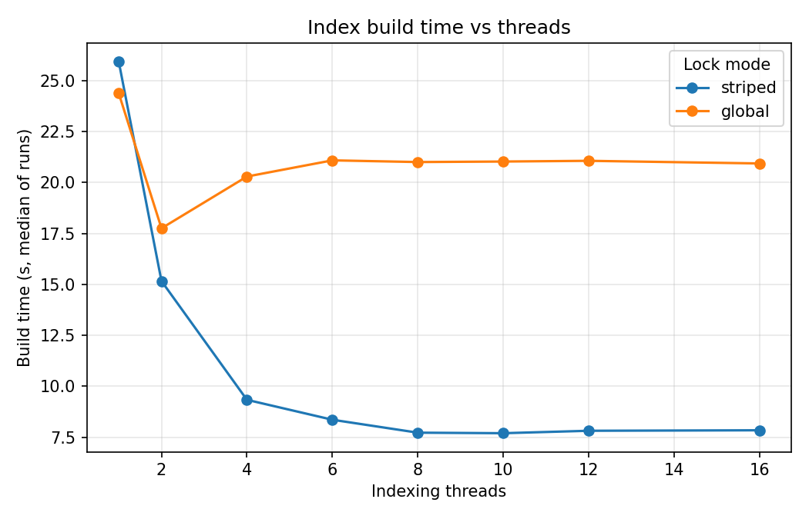
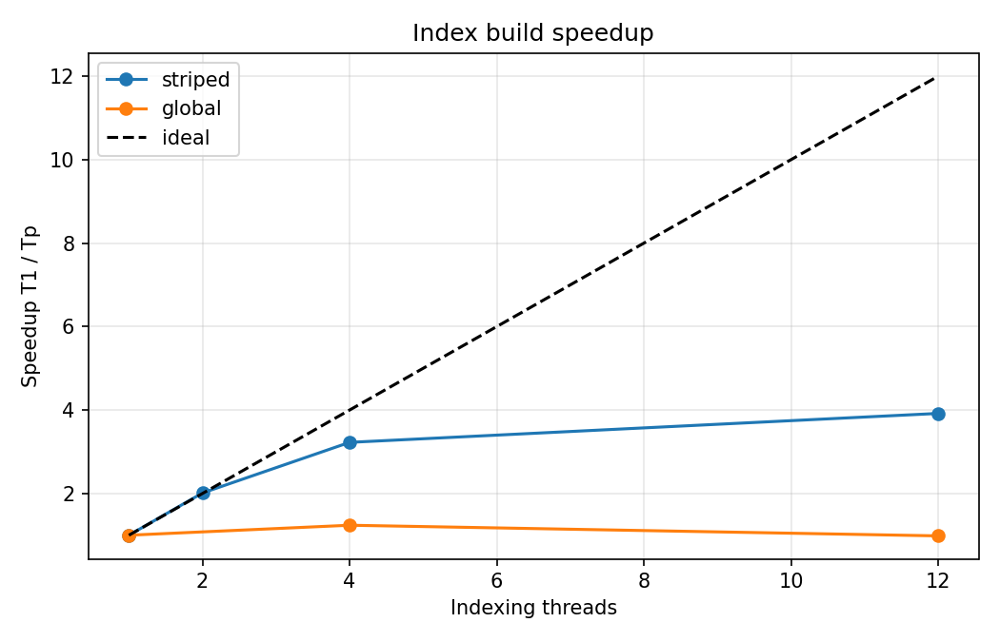
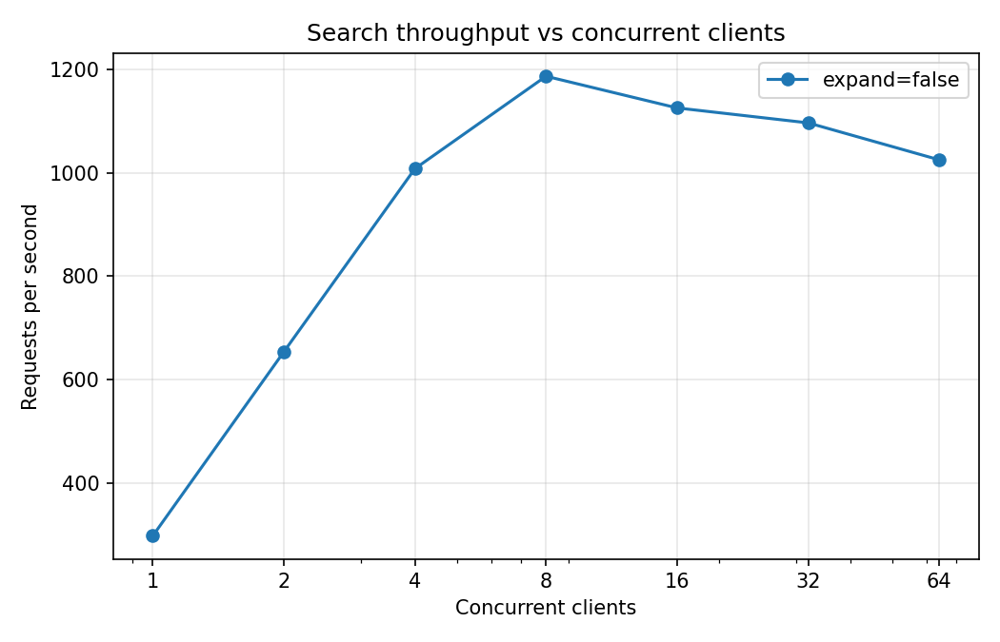
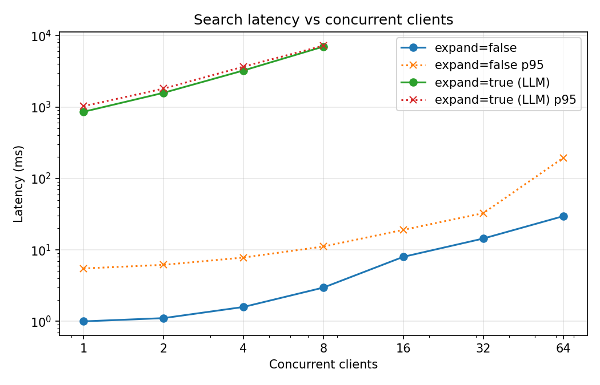

# Пошукова система (BM25 + розширення запиту через Ollama)

## Запуск

```
docker compose up
```

Команда запускає `search-server` (порт 8080) і окремий сервіс `ollama`; ручних кроків немає.
Під час першого запуску `ollama-pull` завантажує модель `gemma4:e2b` (~4.6 ГБ).
Розширення запиту працює, коли `GET /api/health` повертає `"ollama": true`.
Після старту побудуйте індекс:

```
curl -XPOST localhost:8080/api/index -H 'content-type: application/json' -d '{"threads":10}'
```

Щоб використати Ollama на хості (наприклад, з GPU): `docker compose -f docker-compose.yml -f docker-compose.dev.yml up`.

Змінні середовища (задаються в `docker-compose.yml`):

| Змінна | За замовчуванням | Опис |
|---|---|---|
| `DATA_DIR` | `/data` | каталог датасету |
| `DATA_GLOB` | `*.txt` | маска файлів |
| `SEARCH_THREADS` | кількість ядер | потоки за замовчуванням для індексації |
| `OLLAMA_URL` | `http://ollama:11434` | адреса Ollama |
| `OLLAMA_MODEL` | `gemma4:e2b` | модель |
| `OLLAMA_TIMEOUT_MS` | `30000` | таймаут розширення запиту |
| `OLLAMA_NUM_THREAD` | `4` | потоки Ollama; задайте кількість продуктивних ядер (efficiency-ядра гальмують генерацію) |

## Датасет

Шлях: `./data` змонтовано в контейнер як `/data` (`DATA_DIR`). У репозиторії є `data/sample/` (300 документів).
Повний набір (~2 ГБ, англійська Вікіпедія, ~495 тис. файлів) завантажується необов'язковим скриптом `python scripts/fetch_dataset.py` у `data/wiki/`.

Формат: UTF-8 файли `.txt`, один документ на файл, перший рядок — заголовок, далі текст.
`doc_id` — шлях файлу відносно `DATA_DIR` без розширення (наприклад `sample/doc_000`).

## API

Усі JSON-поля — у `snake_case`. Помилки REST: `{"error": string}` зі статусом 400, 404 або 409.

| Метод і шлях | Запит | Відповідь 200 |
|---|---|---|
| `GET /api/health` | — | `{"status": string, "ollama": bool}` |
| `POST /api/index` | `{"threads": int?, "lock_mode": string?, "segments": int?}` | `{"status": string, "documents_indexed": int, "time_ms": long, "threads_used": int, "lock_mode": string}` |
| `GET /api/stats` | — | `{"documents": int, "index_build_time_ms": long, "threads_used": int, "terms": int, "postings": long, "lock_mode": string}` |
| `POST /api/search` | `{"query": string, "mode": string?, "expand": bool?, "top_k": int?}` | `{"results": [Result], "time_ms": long, "expanded_terms": [string]}` |
| `GET /api/doc/{doc_id}` | — | `{"doc_id": string, "title": string, "text": string}` |

`Result` = `{"doc_id": string, "score": double, "snippet": string, "title": string}`.

`POST /api/index` (тіло необов'язкове):
- `threads` — від 1 до 256, за замовчуванням `SEARCH_THREADS`;
- `lock_mode` — `"striped"` (за замовчуванням) або `"global"`;
- `segments` — степінь двійки, за замовчуванням 256;
- `status` завжди `"ok"`; 400 — некоректні параметри або немає каталогу даних; 409 — індексація вже триває.

`POST /api/search`:
- `query` — обов'язковий, не довший за 1000 символів;
- `mode` — лише `"keyword"` (за замовчуванням);
- `expand` — за замовчуванням `true`; якщо `false`, розширення пропускається, `expanded_terms` порожній;
- `top_k` — від 1 до 100, за замовчуванням 10 (значення поза діапазоном обрізається);
- 400 — немає `query`, запит задовгий або невідомий `mode`; 409 — `index not built`.

`GET /api/doc/{doc_id}`: `doc_id` може містити `/`; 404 — `document not found`.

### WebSocket `/ws/search`

Клієнт надсилає текстове повідомлення (до 16 КБ):

```
{"query": string, "top_k": int?}
```

Сервер відповідає повідомленнями `{"stage": string, "data": object}` (для `done` поля `data` немає):

| `stage` | `data` |
|---|---|
| `query_expansion` | `{"original": string, "expanded_terms": [string], "error": string}` (`error` є лише якщо розширення не вдалося; тоді `expanded_terms` порожній) |
| `keyword_search` | `{"results": [Result], "time_ms": long}` |
| `done` | — |
| `error` | `{"message": string}` (немає `query`, запит задовгий, не JSON, повідомлення завелике, `index not built`) |

Порядок: `query_expansion` → `keyword_search` → `done`. Після `error` інших повідомлень для цього запиту немає. З'єднання лишається відкритим для наступних запитів.

## CLI

```
./search [options] "query"       пошук
./search --index [threads]       (пере)побудувати індекс
./search --stats                 статистика індексу
./search --health                стан сервера та Ollama
```

Опції:
- `--rest` — використати `POST /api/search` замість WebSocket;
- `--no-expand` — без розширення запиту (через REST);
- `--top N` — кількість результатів (за замовчуванням 10);
- `--server URL` — адреса сервера (за замовчуванням `$SEARCH_SERVER` або `http://localhost:8080`);
- `--help` — довідка.

Потрібен .NET SDK; перший запуск `./search` збирає CLI автоматично.

## Веб-інтерфейс

Відкрийте `http://localhost:8080`.

## Масштабованість

Вимірювання: 495 846 документів, 10 ядер, Docker (`bench/results/*.csv`, графіки будує `scripts/plot.py`).






- Побудова індексу (striped): 102 с (1 потік) → 41 с (12 потоків), прискорення ~2,5×, плато після ~4 потоків: читання ~495 тис. малих файлів через файлове спільне використання Docker і алокації/GC.
- З глобальним м'ютексом найкраще 2 потоки (79 с), далі час повертається до ~100 с через конкуренцію за м'ютекс.
- Пошук (без розширення): 297 запитів/с (1 клієнт) → пік 1187 запитів/с (8 клієнтів), далі пропускна здатність не росте, а затримка зростає (обмеження — CPU).
- Розширення запиту займає близько 1 с після завантаження моделі (перший запит ≈ 15–20 с); для цього `OLLAMA_NUM_THREAD` має дорівнювати кількості продуктивних ядер (на Apple M4 — 4).

Якість пошуку: [docs/report/search-quality.md](docs/report/search-quality.md).
